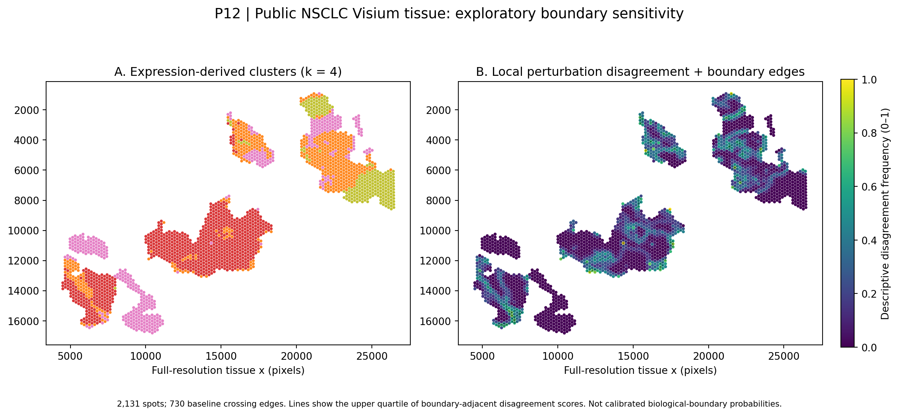
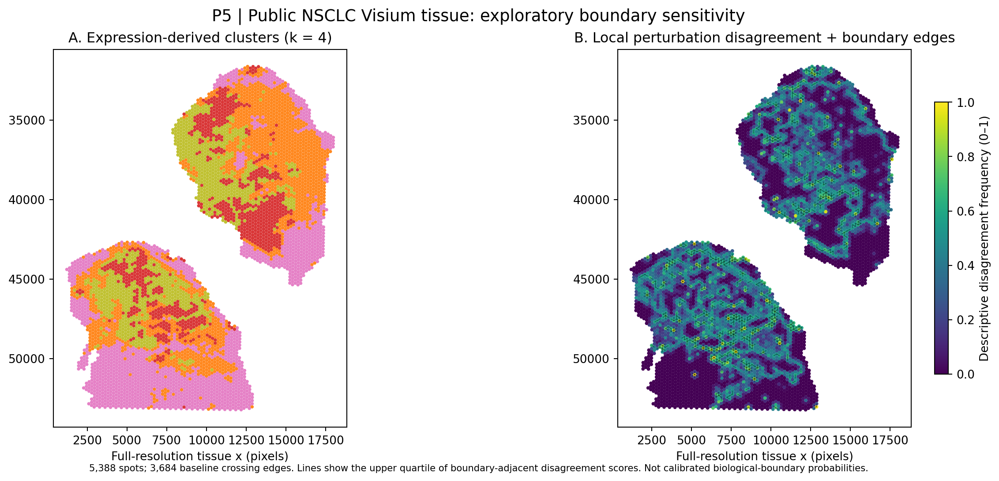

# NSCLC spatial molecular-state boundary sensitivity | Exploratory computational pilot

**Author:** Mila Desi Anasanti, PhD · **Year:** 2026  
**Public data:** GEO [GSE292299](https://www.ncbi.nlm.nih.gov/geo/query/acc.cgi?acc=GSE292299), specimens **P5 / GSM8855707** and **P12 / GSM8855714**.  
**Status:** completed exploratory analysis and transparent hypothesis for future methodological work — **NOT** a validated Boundary-ID method, biological boundary classifier, PRELUNG dataset analysis, clinical biomarker test, or patient-facing diagnostic tool.

## Scientific motivation
Spatial expression clusters can look convincingly structured even when their boundaries depend on count depth, analytic choices, or continuous spatial gradients. We ask whether the **same expression-derived states and boundaries** persist under controlled technical perturbations, while being explicit that depth is often biologically meaningful as well as technically variable.

## Figure 1 — P12 cluster structure and local perturbation disagreement



**Caption.** Original k=4 expression-only clustering (left), and a derived local *perturbation disagreement* visualization (right). The spots are coloured by the fraction of perturbation-run neighbour disagreements, and black connectors highlight the upper quartile of baseline cluster-boundary edges ranked by adjacent local disagreement. The overlay is **an exploratory sensitivity visualisation**, **not** an estimated posterior probability, calibrated uncertainty interval, or inference that any particular edge is biological/technical. Clusters were inferred from RNA expression alone; tissue coordinates were used for adjacency graphs and display, *not to train the clustering*. P12 corresponds to advanced NSCLC, **not** a premalignant lung nodule.

## Figure 2 — P5 boundary sensitivity



## Source specimens and integrity

| Metric | P5 | P12 |
|---|---:|---:|
| Spots matched to in-tissue coordinates | 5,388 | 2,131 |
| RNA Gene Expression features | 18,085 | 18,085 |
| Antibody Capture features deliberately excluded | 35 | 35 |
| Matched spatial graph edges | 15,700 | 5,789 |
| Expression-only clustering | PCA + K-means, k=4 | PCA + K-means, k=4 |

## Quantitative pilot results

| Diagnostic | P5 | P12 |
|---|---:|---:|
| Spearman rho: PC1 vs log RNA counts | +0.868 | -0.951 |
| Mean ARI vs original, 50% count retention (3 runs) | 0.834 | 0.875 |
| Mean ARI vs original, 25% count retention (3 runs) | 0.705 | 0.701 |
| Mean ARI vs original, 25th-percentile depth equalisation (3 runs) | 0.721 | 0.531 |
| ARI after aggressive RNA-depth regression | 0.412 | 0.368 |
| Descriptive boundary-depth AUROC | 0.635 | 0.728 |
| Moran's I of RNA depth on tissue adjacency | 0.833 | 0.858 |

Source tables are in [`results/`](results/), including spot-level metrics, perturbation runs, and baseline edge diagnostics. The AUROC is **descriptive**; spatial edges are non-independent.

## Methods at a glance

```text
Original public Visium FFPE RNA counts + coordinates + histology
         |
RNA-only filtering (exclude Antibody Capture), barcode QC
         |
Library normalization -> log1p -> variable genes -> PCA -> k=4 clustering
         |
Spatial 6-neighbour graph, neighbourhood boundary diagnostics
         |
Count thinning (50%, 25%, equalised depth; 3 runs each)
         |
ARI, local disagreement map, depth regression sensitivity, graph Moran's I
         |
Interpretation conditional on biological/technical confounding
```

Figures: [P5 spatial QC](figures/P5_spatial_analysis.png) · [P12 spatial QC](figures/P12_spatial_analysis.png) · [Count-thinning ARI](figures/cross_sample_thinning_stability.png) · [P5 expression overlays](figures/P5_gene_overlay.png) · [P12 expression overlays](figures/P12_gene_overlay.png).

## Reproduction

This repository purposely excludes all original H5, spatial TAR and H&E files. Obtain them from [GEO](https://www.ncbi.nlm.nih.gov/geo/query/acc.cgi?acc=GSE292299) using [`data/README.md`](data/README.md) and use Python 3.10+.

```bash
python -m pip install -r requirements.txt
python run_analysis.py --input-dir /path/to/local_inputs --output-dir /path/to/output
python extended_checks.py --input-dir /path/to/local_inputs --output-dir /path/to/output
python plot_boundary_uncertainty.py --results-dir /path/to/output --output-dir /path/to/output/figures
```

`run_analysis.py` uses original sparse matrices, validates exact barcode-to-coordinate matching and produces sample/spot metrics. `extended_checks.py` calculates additional exploratory sensitivity and gene maps; `plot_boundary_uncertainty.py` recreates the two-panel figures from derived spot-level metrics without needing to re-read raw sequencing files. For direct figure regeneration from bundled spot metrics:

```bash
python plot_boundary_uncertainty.py --results-dir results --output-dir figures
```

Random seed 26023. This baseline is computationally intensive; floating-point library and platform differences may change cluster labels modestly. The sample-wise results are not a powered estimate of generalisation across patients.

## Boundaries of the evidence

- These are **two independent advanced-NSCLC specimens**, not benign/premalignant/malignant categories or serial disease progression data.
- Expression clusters are **not pathology-validated tumor subregions**. Tissue photographs are illustrative; no annotated histopathology ground truth was available in uploaded materials.
- Count thinning decreases information and therefore cannot reveal what fraction of boundaries are false. Regression of sequencing depth may remove true biologically relevant RNA variation.
- The included simple permutation nulls do not preserve the true spatial covariance structure; corresponding p-values must not be presented as calibrated biological inference.
- No independent DNA, copy-number, radiomic or clinical integration has been performed; none is claimed.
- The current procedures are standard computational tools assembled for feasibility, **not a novel validated clustering or inferential algorithm**.

## Proposed next method — not implemented or validated here

*Conditional boundary identifiability*: define edge-level reliability subject to multiple plausible nuisance explanations (RNA capture variation, biological abundance, spatial covariance), explicitly recognise **unresolved** cases, and validate false-boundary error rates using generative count simulations, held-out patients, and orthogonal pathology/DNA information. [`docs/METHODS_NEXT_STEPS.md`](docs/METHODS_NEXT_STEPS.md) outlines this planned extension. This is a **research direction**, not a demonstrated algorithm or guaranteed innovation.

## Attribution

Public expression and spatial files are credited to the original contributors to GEO series GSE292299. This code and derived summary figures are an independent exploratory secondary analysis. Dataset reuse must comply with the source repository's applicable terms.
